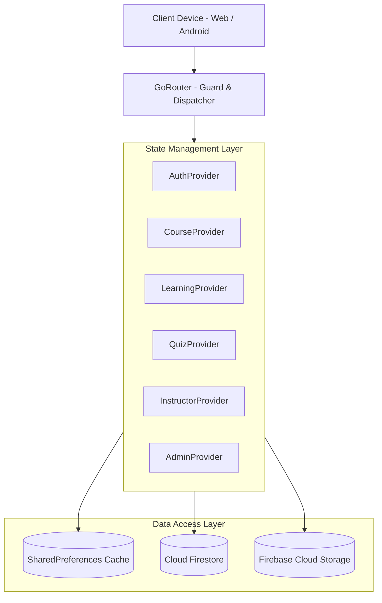
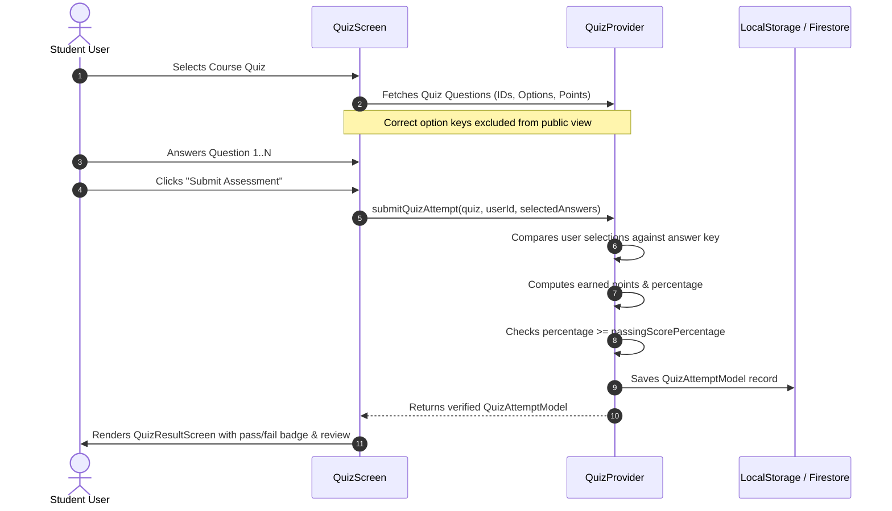

# SYSTEM ARCHITECTURE SPECIFICATION
# Digital Learning Management System (DLMS)

## 1. Architectural Philosophy & Overview
The **Digital Learning Management System (DLMS)** employs a clean, layered feature-first architecture that strictly decouples presentation interfaces, business logic/state controllers, data abstraction boundaries, and cloud/local persistence services.

```
┌──────────────────────────────────────────────────────────────────┐
│                      Presentation Layer                          │
│  - Screens & Viewports (Mobile, Tablet, Desktop)                 │
│  - Reusable Material 3 Design Components                         │
│  - Declarative Route Mapping (GoRouter)                          │
└─────────────────────────────────┬────────────────────────────────┘
                                  │
┌─────────────────────────────────▼────────────────────────────────┐
│                   State Management & Domain                      │
│  - AuthProvider (Session, Identity, Roles)                       │
│  - CourseProvider (Catalog, Search, Filtering, Bookmarks)        │
│  - LearningProvider (Enrollments, Progress, Lesson Completions)  │
│  - QuizProvider (Authoritative Grading, Assessments, History)    │
│  - InstructorProvider (Curriculum Creation & Cohort Analytics)   │
│  - AdminProvider (User Governance, Moderation, Announcements)    │
└─────────────────────────────────┬────────────────────────────────┘
                                  │
┌─────────────────────────────────▼────────────────────────────────┐
│                   Data & Persistence Layer                       │
│  - LocalStorageService (SharedPreferences Cache & Reading State) │
│  - Cloud Firestore Repositories (NoSQL Data Models)              │
│  - Firebase Authentication Service (Token Verification)          │
│  - Firebase Storage Service (Media Assets & Resources)           │
└──────────────────────────────────────────────────────────────────┘
```

---

## 2. Structural Layer Descriptions

### Layer 1: Presentation & UI
- **Responsive Layout Engine (`ResponsiveLayout`)**: Dynamically swaps between Mobile (<650px), Tablet (650-1050px), and Desktop/Web (>1050px) configurations without rebuild jank or overflow errors.
- **Material 3 Design Tokens**: Governed by `AppTheme`, utilizing academic typography (Google Fonts Inter), crisp contrast ratios, and tailored color accents.
- **Declarative Navigation (`app_router.dart`)**: Uses `go_router` with URL routing, parameter parsing (`/lesson/:courseId/:lessonId`), and role guard intercepts.

### Layer 2: State Management & Application Logic
- **Decoupled Providers**: Built on Flutter's `provider` package using `ChangeNotifier` and `ProxyProvider` dependencies.
- **Authoritative Grading Engine**: Enforces that quiz percentages and pass/fail statuses are computed programmatically against question points rather than accepting client-submitted totals.
- **Progress Tracking**: Course completion percentage is calculated strictly using `completedLessons.length / totalLessons` to guarantee academic integrity.

### Layer 3: Persistence & Dual-Service Architecture
- **Offline / Low-Bandwidth Resilience**: Course curricula, accessed lesson reading state, and enrollment records are cached in `SharedPreferences` to ensure continuous functionality in low-connectivity areas.
- **Firebase Integration Layer**: Direct integration with Firebase Authentication, Cloud Firestore, and Firebase Storage governed by `firestore.rules`.

---

## 3. High-Level Architectural Diagrams

### 3.1 Layered Data Flow Architecture


### 3.2 Quiz Execution & Authoritative Grading Sequence


---

## 4. Architectural Quality Attributes
- **Maintainability**: Feature-driven directory layout ensures that additions to courses, quizzes, or admin modules do not touch unrelated logic.
- **Testability**: Independent models and providers allow unit testing without requiring real network sockets.
- **Security**: Separation of privilege between Students, Instructors, and Administrators enforced through route guards and Firestore rules.
